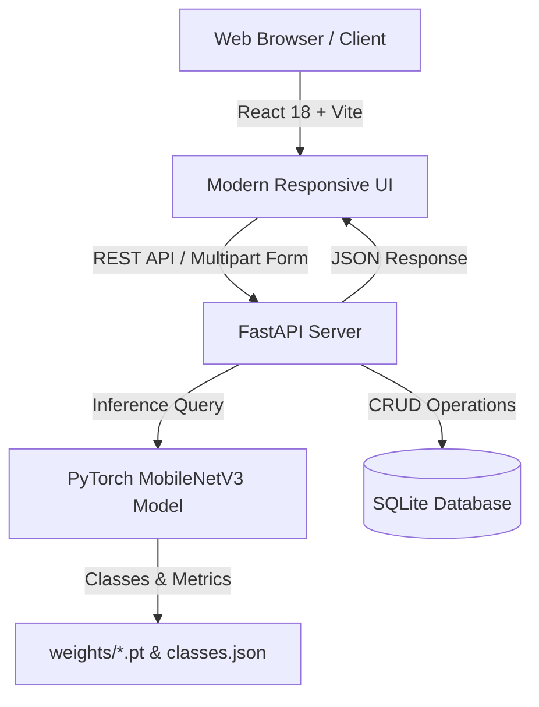

# 🌊 MarineLife AI – Intelligent Marine Species Identification & Conservation Platform

[](https://sdgs.un.org/goals/goal14)
[](https://fastapi.tiangolo.com)
[](https://pytorch.org)
[](https://react.dev)
[](https://vitejs.dev)

> **MarineLife AI** is a state-of-the-art computer vision and biodiversity intelligence platform dedicated to marine ecosystem conservation, aligned with **United Nations Sustainable Development Goal 14 (Life Below Water)**. It enables citizen scientists, marine biologists, and ocean advocates to identify marine species from underwater imagery, assess ecological vulnerability, and monitor marine biodiversity in real time.

---

## 🌟 Key Features

- 🧠 **Deep Learning Species Identification**: Fine-tuned **MobileNetV3-Small** deep neural network delivering lightweight, low-latency, and high-accuracy classification across diverse marine taxa.
- 🐠 **Comprehensive Marine Species Database**: Detailed morphological, ecological, habitat, depth distribution, and diet profiles across key marine species.
- 🛡️ **IUCN Red List Status & Threats Tracking**: Live conservation status tracking (Critically Endangered, Endangered, Vulnerable, Least Concern) with actionable protection guidelines.
- 🗺️ **Ocean Habitat & Geographic Mapping**: Spatial distribution tracking across coral reefs, pelagic open oceans, abyssal zones, and coastal waters.
- 📈 **Conservation Analytics & SDG 14 Metrics**: Dynamic telemetry on observation trends, threat severity levels, and classification model confidence.
- 📸 **Drag-and-Drop Classification Interface**: Interactive image upload with instant prediction, probability distribution, and one-click sample image testing.

---

## 🔬 Species Coverage

The AI model is trained to recognize iconic and vulnerable ocean species:
1. **Blue Whale** (*Balaenoptera musculus*) — Endangered
2. **Great White Shark** (*Carcharodon carcharias*) — Vulnerable
3. **Bottlenose Dolphin** (*Tursiops truncatus*) — Least Concern
4. **Green Sea Turtle** (*Chelonia mydas*) — Endangered
5. **Giant Manta Ray** (*Mobula birostris*) — Endangered
6. **Ocellaris Clownfish** (*Amphiprion ocellaris*) — Least Concern
7. **Red Lionfish** (*Pterois volitans*) — Least Concern / Invasive Threat
8. **Common Octopus** (*Octopus vulgaris*) — Least Concern
9. **Moon Jellyfish** (*Aurelia aurita*) — Least Concern
10. **White's Seahorse** (*Hippocampus whitei*) — Endangered

---

## 🛠️ Architecture & Tech Stack



- **Frontend**: React 18, Vite, Lucide Icons, Modern Responsive CSS
- **Backend**: FastAPI, SQLAlchemy ORM, Pydantic, Python 3.10+
- **Machine Learning**: PyTorch, Torchvision (MobileNetV3-Small), Pillow, NumPy
- **Database**: SQLite (Automated seeding with rich biodiversity data)

---

## 🚀 Getting Started

### Prerequisites
- **Python 3.10+**
- **Node.js 18+ & npm**
- **Git**

---

### 1. Clone the Repository
```bash
git clone https://github.com/Gowtham-projects-io/MarineLife-AI.git
cd MarineLife-AI
```

---

### 2. Backend Setup & Run
```bash
# Navigate to backend directory
cd backend

# Create and activate virtual environment
# Windows:
python -m venv venv
.\venv\Scripts\activate
# macOS / Linux:
# python3 -m venv venv
# source venv/bin/activate

# Install Python dependencies
pip install -r requirements.txt

# Start FastAPI server
python -m uvicorn main:app --reload --host 127.0.0.1 --port 8000
```
API Documentation will be live at: `http://localhost:8000/docs`

---

### 3. Frontend Setup & Run
```bash
# In a new terminal, navigate to frontend directory
cd frontend

# Install npm packages
npm install

# Start Vite development server
npm run dev
```
Open your browser at: `http://localhost:5173`

---

## 📡 API Reference

| Method | Endpoint | Description |
|---|---|---|
| `GET` | `/api/species` | Retrieve all marine species with conservation metadata |
| `GET` | `/api/species/{id}` | Retrieve specific species profile by ID or scientific name |
| `POST` | `/api/predict` | Upload image for PyTorch AI species classification |
| `GET` | `/api/metrics` | Retrieve model performance and dataset statistics |
| `GET` | `/api/sample-images` | Get preloaded test sample images for demonstration |
| `GET` | `/api/observations` | View recent marine species sighting logs |

---

## 🌍 UN Sustainable Development Goal 14 Alignment

Targeting **SDG 14: Conserve and sustainably use the oceans, seas and marine resources**:
- **Target 14.2**: Protect and restore marine & coastal ecosystems.
- **Target 14.4**: End destructive fishing & track vulnerable predatory species.
- **Target 14.a**: Increase scientific knowledge and research capacity for ocean health.

---

## 📄 License

This project is licensed under the MIT License — see the [LICENSE](LICENSE) file for details.
